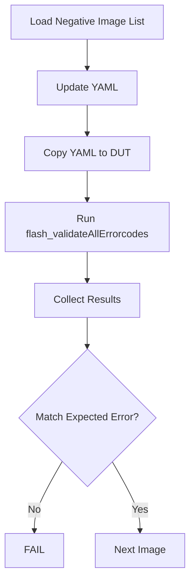
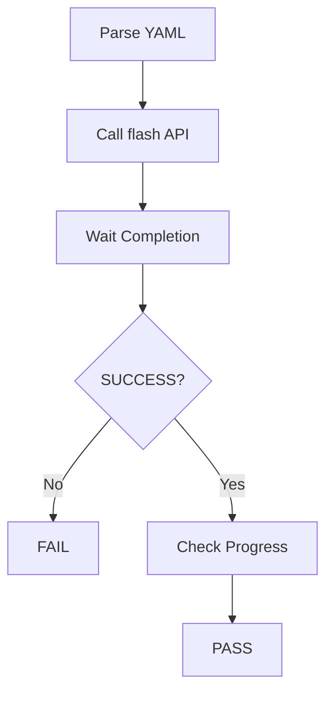
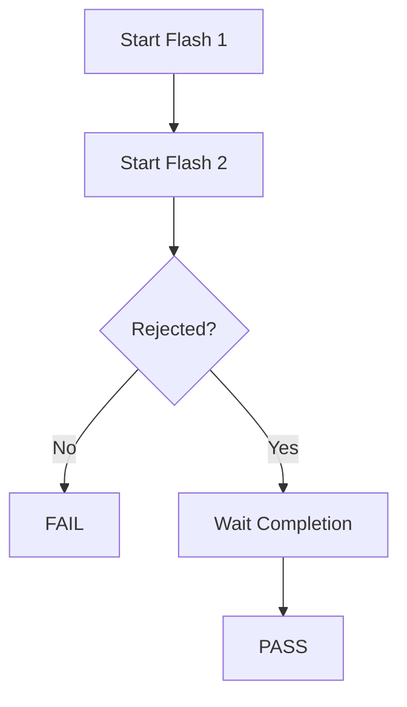
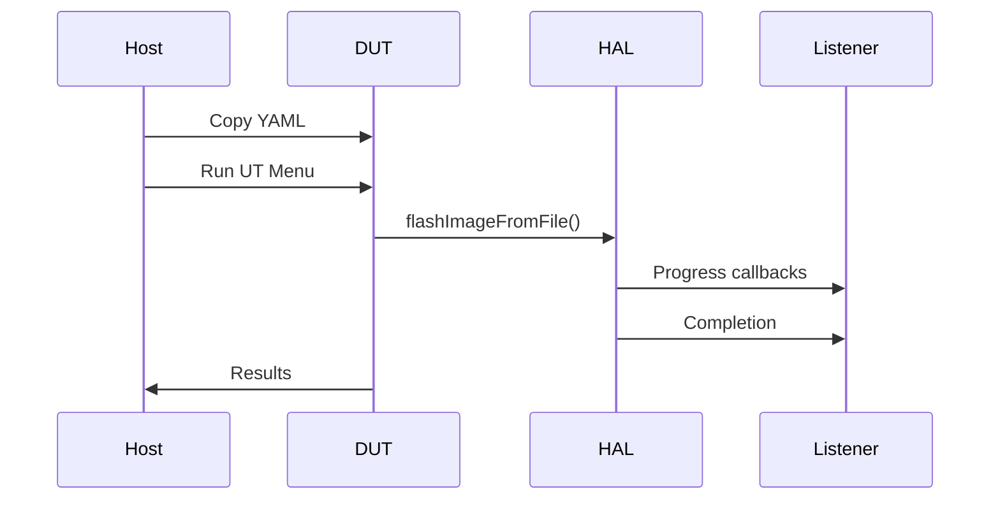

# Flash HAL L1, L3 Test Procedure

## Table of Contents

* [Acronyms, Terms and Abbreviations](#acronyms-terms-and-abbreviations)
* [Build the VTS](#build-the-vts)
* [Run L1 Tests Without Python](#run-l1-tests-without-python)
* [Run Tests in Python Environment](#run-tests-in-python-environment)

  * [Update Configuration Files](#update-configuration-files)
  * [Install Python Packages](#install-python-packages)
  * [Run Test Cases](#run-test-cases)
* [L3 Test Cases](#l3-test-cases)
* [Notes](#notes)

---

## Acronyms, Terms and Abbreviations

* `HAL`  - Hardware Abstraction Layer
* `VTS`  - Vendor Test Suite
* `L1`   - Level 1 Testing
* `L2`   - Level 2 Testing
* `L3`   - Level 3 Testing
* `DUT`  - Device Under Test
* `RAFT` - Rapid Automation Framework for Testing
* `YAML` - YAML Ain't Markup Language
* `AIDL` - Android Interface Definition Language

---

## Build the VTS

### Build Linux Binder

```bash
git clone -b develop https://github.com/rdkcentral/linux_binder_idl.git
cd linux_binder_idl
./build-linux-binder-aidl.sh 64
```

---

### Build Flash VTS

```bash
git clone git@github.com:rdkcentral/rdk-halif-aidl-test-flash.git
cd rdk-halif-aidl-test-flash
```

### Environment Variables

```bash
export UT_CORE_VERSION=5.0.0
export RDK_HALIF_AIDL_VERSION=0.14.0
export VCOMPONENT_FLASH_VERSION=0.1.0
export AIDL_BIN=/path/to/aidl
export LINUX_BINDER_OUT_DIR=/path/to/local
```

Enable logs (optional):

```bash
export ENABLE_UT_INFO_LOGGING=1
```

### Build

```bash
./build.sh Target=linux
```

Output:

* Binary: `build/bin/`
* Tar: `vts-Flash.tar.gz`

---

## Run L1 Tests Without Python

### Copy to DUT

```bash
scp vts-Flash.tar.gz root@<DUT>:/tmp/
```

### Extract

```bash
ssh root@<DUT>
mkdir /tmp/flash
tar -zxf vts-Flash.tar.gz -C /tmp/flash
cd /tmp/flash
```

### Run Tests

```bash
./run.sh
```

---

## Run Tests in Python Environment

### Update Configuration Files

#### Rack Configuration

* Configure:

  * `ssh_hal_test`
  * `ssh_hal_test_1`
* Ensure DUT connectivity

---

#### Device Configuration

```yaml
deviceConfig:
  cpe1:
    platform: "your_platform"
    target_directory: "/tmp/"
    wait_time: 40
    test:
      profile: "../../profiles/hfp-flash-vcomponent.yaml"
```

---

## Install Python Packages

```bash
./install.sh
source activate_venv.sh
./install.sh
```

---

## Run Test Cases

### L1

```bash
python vts_flash_L1_tests.py \
--config <rack_config> \
--deviceConfig <device_config>
```

---

### L3

```bash
python <vts_flash_L3_xxx>.py \
--config <rack_config> \
--deviceConfig <device_config>
```

---

# L3 Test Cases

**Test Configuration File:**
`vts_l3_flash.yaml`

---

## 1. Validate All Error Codes — `vts_flash_L3_TestAllImages.py`

### Purpose

Validates Flash HAL behavior for **all negative image scenarios**.

---

### Test Flow



---

### Test Steps

* Read negative images from config
* Update YAML dynamically
* Execute test on DUT
* Validate returned error codes

---

### Expected Results

| Input Image       | Expected Result               |
| ----------------- | ----------------------------- |
| Invalid type      | ERROR_IMAGE_INVALID_TYPE      |
| Invalid size      | ERROR_IMAGE_INVALID_SIZE      |
| Invalid signature | ERROR_IMAGE_INVALID_SIGNATURE |
| Verify fail       | ERROR_FLASH_VERIFY_FAILED     |

---

---

## 2. Validate Flash Success — `flash_imageTypes`

### Purpose

Validates successful flashing of **valid images**.

---

### Test Flow



---

### Test Steps

* Load valid image
* Call `flashImageFromFile`
* Monitor progress
* Validate:

  * Progress: 0 → 100
  * Final result: SUCCESS

---

---

## 3. Validate Concurrent Flash Rejection — `flash_concurrentReject`

### Purpose

Ensures Flash HAL rejects parallel flash requests.

---

### Test Flow



---

### Test Steps

* Start first flash
* Immediately trigger second
* Validate:

  * Second request rejected
  * First completes successfully

---

---

## Host–DUT Interaction Model

### Key Characteristics

* Fully **host-driven**
* YAML updated dynamically
* No reboot required
* No UT-controller used

---

### Sequence Diagram



---

## Notes

### Image Location

Ensure all images exist at:

```
/assets/flashfiles/input/
```

---

### Timeout Configuration

Defined in YAML:

```yaml
Flash:
  overall:
    maxFlashWaitDurationMs: 900000
```

---

### Common Failures

| Issue            | Cause                    |
| ---------------- | ------------------------ |
| Timeout          | Large image / slow flash |
| Wrong error code | Incorrect test image     |
| No progress      | Listener not registered  |

---

### Windows Notes

* Remove:

```python
import pty
import fcntl
```

---
