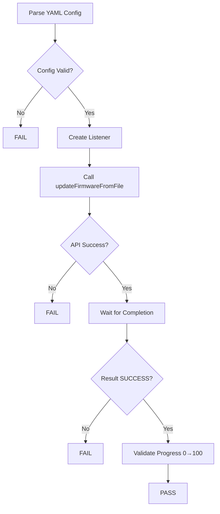
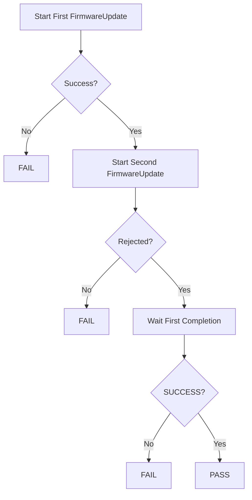
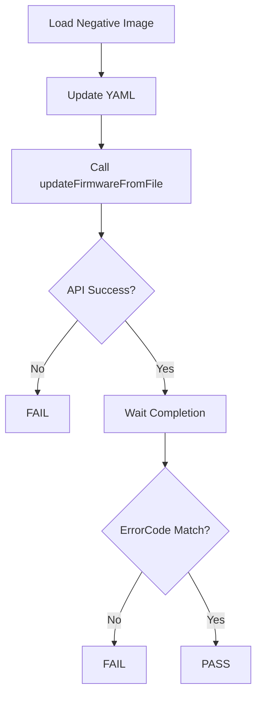

# FirmwareUpdate HAL L3 Low Level Test Specification and Procedure Documentation

## Table of Contents

* [Scope](#scope)
* [Level 3 Test Procedure](#level-3-test-procedure)
* [Level 3 Test Cases Overview](#level-3-test-cases-overview)

---

## Scope

This document describes the Level 3 (L3) Low Level Test Specification for the FirmwareUpdate HAL.

L3 testing validates end-to-end FirmwareUpdate HAL functionality using real device operations, including:

* Updating valid Firmware images
* Handling invalid/corrupted images
* Verifying error codes
* Concurrent request handling
* Progress callback validation

---

## Level 3 Test Procedure

The L3 FirmwareUpdate test suite performs:

1. YAML configuration parsing (image + expected result)
2. File transfer to DUT
3. Execution of FirmwareUpdate HAL APIs via UT framework
4. Monitoring progress via listener callbacks
5. Validation of final FirmwareUpdate result and error codes

---

## Level 3 Test Cases Overview

| Test Case                   | Description                                           | HAL APIs                       |
| --------------------------- | ----------------------------------------------------- | ------------------------------ |
| firmwareupdate_imageTypes            | Validate updating of valid image types                | `IFirmwareUpdate::updateFirmwareFromFile()` |
| firmwareupdate_concurrentReject      | Validate rejection of concurrent FirmwareUpdate requests       | `IFirmwareUpdate::updateFirmwareFromFile()` |
| firmwareupdate_validateAllErrorcodes | Validate all negative image scenarios and error codes | `IFirmwareUpdate::updateFirmwareFromFile()` |

---

# Test Case Details

---

## Test 1: firmwareupdate_imageTypes

| Title         | Details                                                                                              |
| ------------- | ---------------------------------------------------------------------------------------------------- |
| Function Name | `firmwareupdate_imageTypes`                                                                          |
| Description   | Validates updating of supported image types and ensures progress callbacks and successful completion |
| Test Group    | 03                                                                                                   |
| Test Case ID  | 001                                                                                                  |
| Priority      | High                                                                                                 |

### Pre-Conditions

* A valid image file must be present on the DUT, and its path must be updated in [test_configuration/vts_firmwareupdate_image_config.yaml](../../test_configuration/vts_firmwareupdate_image_config.yaml)
* YAML updated dynamically by host test
[test_configuration/vts_l3_firmwareupdate.yaml](../../test_configuration/vts_l3_firmwareupdate.yaml)
* FirmwareUpdate HAL service must be running
* Listener interface must be registered

### Dependencies

* FirmwareUpdate HAL Interface: [IFirmwareUpdate](https://github.com/rdkcentral/rdk-halif-aidl/blob/0.15.0/firmwareupdate/current/com/rdk/hal/firmwareupdate/IFirmwareUpdate.aidl)
* YAML Configuration: [test_configuration/vts_l3_firmwareupdate.yaml](../../test_configuration/vts_l3_firmwareupdate.yaml)
* UT Framework

### User Interaction

No

---

### Test Flow Diagram

---

### Test Procedure

| Step | Description              | Test Data     | Expected Result            |
| ---- | ------------------------ | ------------- | -------------------------- |
| 1    | Parse YAML configuration | FirmwareUpdate.L3.Test | Config parsed successfully |
| 2    | Get filename & listener  | Valid image   | Inputs valid               |
| 3    | Call API                 | filename      | API returns success        |
| 4    | Monitor progress         | Listener      | Progress from 0 to 100     |
| 5    | Wait for completion      | Timeout       | Completion received        |
| 6    | Validate result          | SUCCESS       | Test PASS                  |

---

## Test 2: firmwareupdate_concurrentReject

| Title         | Details                                               |
| ------------- | ----------------------------------------------------- |
| Function Name | `firmwareupdate_concurrentReject`                     |
| Description   | Validates that concurrent FirmwareUpdate requests are rejected |
| Test Group    | 03                                                    |
| Test Case ID  | 002                                                   |
| Priority      | High                                                  |

### Pre-Conditions

* A valid image file must be present on the DUT, and its path must be updated in [test_configuration/vts_firmwareupdate_image_config.yaml](../../test_configuration/vts_firmwareupdate_image_config.yaml)
* YAML updated dynamically by host test
[test_configuration/vts_l3_firmwareupdate.yaml](../../test_configuration/vts_l3_firmwareupdate.yaml)
* FirmwareUpdate HAL service running

### Dependencies

* FirmwareUpdate HAL Interface: [IFirmwareUpdate](https://github.com/rdkcentral/rdk-halif-aidl/blob/0.15.0/firmwareupdate/current/com/rdk/hal/firmwareupdate/IFirmwareUpdate.aidl)
* Listener implementation

### User Interaction

No

---

### Test Flow Diagram

---

### Test Procedure

| Step | Description        | Test Data | Expected Result        |
| ---- | ------------------ | --------- | ---------------------- |
| 1    | Start first FirmwareUpdate  | filename  | Success                |
| 2    | Start second FirmwareUpdate | same file | Rejected (ret=false)   |
| 3    | Wait completion    | listener1 | Completes successfully |
| 4    | Validate result    | SUCCESS   | Test PASS              |

---

## Test 3: firmwareupdate_validateAllErrorcodes

| Title         | Details                                                             |
| ------------- | ------------------------------------------------------------------- |
| Function Name | `firmwareupdate_validateAllErrorcodes`                              |
| Description   | Validates FirmwareUpdate HAL behavior for all invalid images and error codes |
| Test Group    | 03                                                                  |
| Test Case ID  | 003                                                                 |
| Priority      | High                                                                |

### Pre-Conditions
* All error-simulating image files must be present on the DUT, and their paths must be updated in [test_configuration/vts_firmwareupdate_image_config.yaml](../../test_configuration/vts_firmwareupdate_image_config.yaml)
* YAML updated dynamically by host test
[test_configuration/vts_l3_firmwareupdate.yaml](../../test_configuration/vts_l3_firmwareupdate.yaml)
### Dependencies

* FirmwareUpdate HAL Interface: [IFirmwareUpdate](https://github.com/rdkcentral/rdk-halif-aidl/blob/0.15.0/firmwareupdate/current/com/rdk/hal/firmwareupdate/IFirmwareUpdate.aidl)
* Host-side script updates YAML
* Error code mapping

### User Interaction

No

---

### Test Flow Diagram

---

### Test Procedure

| Step | Description         | Test Data         | Expected Result |
| ---- | ------------------- | ----------------- | --------------- |
| 1    | Load negative image | invalid file      | Ready           |
| 2    | Update YAML         | expected error    | Config updated  |
| 3    | Call API            | filename          | API success     |
| 4    | Wait completion     | listener          | Completed       |
| 5    | Validate error      | expectedErrorCode | Matches         |
| 6    | Ensure not success  | != SUCCESS        | Test PASS       |

---

## References

* FirmwareUpdate HAL Interface: [IFirmwareUpdate](https://github.com/rdkcentral/rdk-halif-aidl/blob/0.15.0/firmwareupdate/current/com/rdk/hal/firmwareupdate/IFirmwareUpdate.aidl)
* L3 Config: [test_configuration/vts_l3_firmwareupdate.yaml](../../test_configuration/vts_l3_firmwareupdate.yaml)
* Image Config: [test_configuration/vts_firmwareupdate_image_config.yaml](../../test_configuration/vts_firmwareupdate_image_config.yaml)

---
